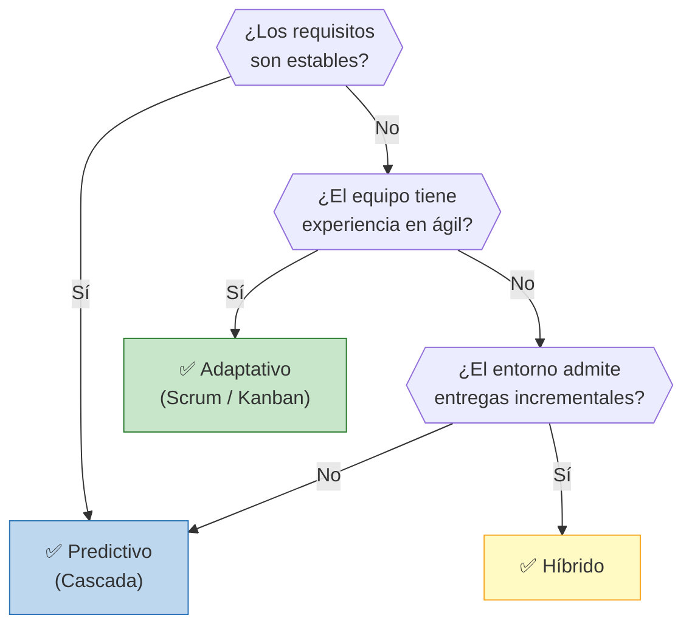
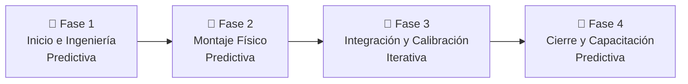

# 🔄 Ciclo de Vida del Proyecto

> Proyecto: Sistema integrado de detección de intrusiones y videovigilancia perimetral. Concesionaria y distribuidora oficial de maquinaria pesada y equipos viales, predio logístico con galpones de servicio técnico y patio exterior, región NEA.
>
> En resumen: ciclo de vida híbrido. La obra física (ingeniería, compras y montaje) se gestiona de forma predictiva, con presupuesto cerrado y fecha fija, y la integración y calibración en el sitio se resuelve en ciclos iterativos de prueba y ajuste. Cuatro fases con compuertas de control, cuatro roles con tres niveles de decisión y cinco entregables con criterios de aceptación objetivos.
>
> Definición institucional: los cuatro integrantes NO son empleados de la concesionaria. Son los ingenieros y directores técnicos de una EMPRESA INTEGRADORA de ingeniería y seguridad electrónica. Es un contrato formal llave en mano, con delimitación contractual entre el cliente que financia y valida, y el equipo que planifica, compra, dirige la obra y calibra los sistemas.

## Caracterización del proyecto

| Característica | Valoración | Comentario |
|----------------|:----------:|------------|
| Estabilidad y claridad de los requisitos | Media | Núcleo tecnológico firme (cámaras, sensores, UPS), pero reglas operativas, perfiles en app (Ley 25.326) y zonas según rotación de maquinaria sujetas a calibración. |
| Incertidumbre técnica | Media | Equipos comerciales maduros, pero alta variabilidad en el entorno exterior: clima extremo del NEA (tormentas, calor), riesgo de falsas alarmas y sombras de tractores. |
| Complejidad del producto | Media | Integración de cuatro subsistemas: obra eléctrica / red, sensores perimetrales, plataforma de software / app móvil y enlace con central de monitoreo. |
| Tamaño del equipo | Pequeño (4 personas) | Equipo de ingeniería directo y ágil. La mano de obra física pesada de tendido y postes se delega en cuadrilla externa bajo supervisión. |
| Experiencia y disponibilidad del equipo | Media | Base sólida en ingeniería y redes con aprendizaje específico en sensores. Dedicación parcial estructurada (10 a 15 horas semanales por miembro) que exige hitos claros. |
| Posibilidad de entregas o validaciones incrementales | Media | Entrega física final única (llave en mano), pero exige validaciones incrementales: pruebas de concepto de sensores, ensayos de autonomía UPS y calibración de app. |
| Restricciones del entorno: plazos | Alta (Rígida) | Fecha límite fija impuesta por la temporada de mayor recepción de maquinaria pesada. Urgencia operativa para cerrar la vulnerabilidad nocturna. |
| Restricciones del entorno: presupuesto | Media - Alta | Presupuesto de inversión inicial con techo global cerrado. Requiere cotizaciones firmes con un margen de contingencia gestionable para imprevistos. |
| Restricciones del entorno: componentes críticos | Media - Alta | Dependencia de hardware intemperie (IP66 / IK10, cables UV), homologación de protocolos con la central externa y no interrumpir la operativa comercial del predio. |

## Alternativas consideradas

> Se evaluaron tres alternativas. Las dos primeras son los enfoques puros, y se explica por qué no alcanzan.

| Criterio | Alternativa A: Predictivo puro (Cascada tradicional) | Alternativa B: Adaptativo puro (Scrum / Adaptativo integral) | Alternativa C: Híbrido (elegida) |
|----------|----------------------------|----------------------------|----------------------------|
| Ventajas para este proyecto | Alcance, costo y plazo definidos desde el inicio. Orden claro para compras y obra. | Flexibilidad total para ajustar en cada sprint. Aprendizaje continuo en sitio. | Base predictiva para ingeniería, compras y montaje: el cliente decide con costo y plazo de referencia. Ciclos iterativos para integración y calibración: los problemas que dependen del sitio se corrigen antes de la entrega. |
| Desventajas / riesgos | Asume que un diseño en papel puede preverlo todo. En un predio abierto del NEA, instalar y entregar a ciegas al final traería problemas serios: sensores que se disparan por ramas o ráfagas de viento norte, y cámaras tapadas por el movimiento dinámico del stock de maquinaria. | No se pueden comprar postes, cavar zanjas y tirar cables de intemperie mediante sprints de dos semanas con alcance flexible. Las compras requieren cotizaciones cerradas, pliegos técnicos y no se puede alterar el presupuesto acordado con la gerencia. | Hay más prácticas que coordinar y hace falta una regla clara sobre cuándo cambia la línea base. Por eso todo cambio de alcance, costo o plazo pasa por el Nivel 3 de decisión. |
| Encaje con las características del proyecto | Encaja con presupuesto cerrado y fecha fija, pero no con la incertidumbre ambiental ni con la calibración en sitio. | Encaja con la calibración ambiental, pero no con compras, obra física ni presupuesto cerrado. | Encaja con el Desafío Dual: dominio físico rígido + dominio lógico y ambiental flexible. |

## Enfoque seleccionado

> **Híbrido: base predictiva + ciclos iterativos en Fase 3**

**Justificación:** El proyecto responde al denominado Desafío Dual: la convivencia forzosa y armónica entre una obra física de ingeniería rígida y un proceso de calibración ambiental y software altamente flexible. La obra física (postes, zanjas, cañerías y cables UV, adquisición de cámaras IP, NVR y UPS) tiene alta rigidez: rehacerla es carísimo, tolerancia al cambio baja, y requiere presupuesto cerrado y plazos estrictos antes del acopio. El dominio lógico y ambiental (calibración en terreno de sensores, filtrado ambiental por calor, viento y lluvia del NEA, puntos ciegos por movimiento de maquinaria, enlace con software de central externa, perfiles en app móvil según Ley 25.326) solo se resuelve probando en el sitio, con aprendizaje por ciclos y retroalimentación. Por eso la ingeniería, las compras y el montaje son predictivos, y la integración y calibración son iterativas.

## Árbol de decisión (ayuda)

**Recorrido seguido en este proyecto:**

1. ¿Los requisitos son estables? No del todo. El núcleo físico está definido (cámaras, sensores, UPS), pero las reglas operativas, los perfiles de la app y las zonas según la rotación de maquinaria se ajustan en el sitio.
2. ¿El equipo tiene experiencia en metodologías ágiles? No de forma consolidada, por lo que se descarta un enfoque adaptativo puro.
3. ¿El entorno admite entregas o validaciones incrementales? Sí: la entrega física es única, pero se valida por hitos (ingeniería, red, calibración y simulacros).
4. Resultado: enfoque híbrido, con base predictiva y ciclos iterativos. Coincide con el criterio general de la guía de Wrike: métodos secuenciales cuando el alcance está definido y ágiles cuando cambia.

## Fases del proyecto

Cada fase cuenta con un objetivo delimitado, actividades clave y un criterio de salida verificable (Quality Gate) que debe cumplirse para autorizar el paso a la fase siguiente.

| Fase | Nombre | Objetivo | Criterio de salida |
|------|--------|----------|-------------------|
| 1 | Inicio e Ingeniería [Predictiva] | Definir especificaciones técnicas, validar presupuesto y emitir compras firmes. Actividades: relevamiento planimétrico del patio; selección y cotización de equipos IP66; pliego de montaje para la cuadrilla; coordinación previa con central externa. | Plan de Ingeniería Aprobado por Cliente + Órdenes de Compra emitidas. |
| 2 | Montaje Físico [Predictiva] | Ejecutar la obra de canalizaciones, cableado y montaje mecánico de equipos. Actividades: zanjeo perimetral y colocación de caños; tendido de cable de red exterior UV; fijación de postes y montaje de cámaras; instalación de rack y UPS en galpón. | Acta de Montaje Físico firmada + 100% de dispositivos con Ping de red exitoso. |
| 3 | Integración y Calibración [Iterativa] | Calibrar sensores en terreno, configurar software y validar enlace externo. Actividades: ensayos de cruce y ajuste fino de filtros; eliminación de sombras de maquinaria; configuración del VMS (software de gestión de video) y app móvil; pruebas de disparo con central externa. | Informe Técnico: 7 días seguidos sin falsas alarmas + Enlace verificado. |
| 4 | Cierre y Capacitación [Predictiva] | Transferir la operación al cliente, capacitar al personal y cerrar el contrato. Actividades: simulacro diurno / nocturno de intrusión; prueba de corte y autonomía real UPS; capacitación a sereno y administración; confección de planos conforme a obra. | Acta de Recepción Definitiva firmada por la Gerencia del Cliente. |

## Adaptación del enfoque (tailoring)

> Del enfoque predictivo tomamos la línea base, las compuertas y el control de cambios; de Scrum y Kanban, solo las prácticas que aportan aprendizaje y visibilidad en la Fase 3.

| Práctica | Origen | Cómo la usamos | Por qué |
|----------|--------|----------------|---------|
| Línea base de alcance, costo y cronograma, con control de cambios | Predictivo (PMBOK) | Se fija al salir de la Fase 1. Los cambios posteriores siguen el Nivel 3 de decisión. | El presupuesto es cerrado y la fecha límite es fija. |
| Compuertas de control por fase | Predictivo | Cada fase termina con un hito verificable; sin él no se pasa a la siguiente. | Rehacer obra física es caro; conviene detectar el problema antes de avanzar. |
| Ruta crítica | Predictivo (CPM) | Ordena compras, obra civil y montaje en las Fases 1 y 2. | Los plazos de compra y la obra condicionan la fecha de entrega. |
| Registro de riesgos | Predictivo (PMBOK) | Se crea en la Fase 1 y se revisa en la reunión semanal. | Hay dependencias externas: proveedores, cuadrilla, central de monitoreo y clima. |
| Ciclos cortos de prueba y ajuste, con revisión al cierre | Scrum | Solo en la Fase 3: se prueba, se ajusta y se revisa el resultado con el cliente. Se empieza por un sector y lo aprendido se aplica al resto. | La calibración en intemperie y la adopción de la app solo se resuelven probando en el sitio. |
| Lista priorizada de ajustes (backlog) | Scrum | En la Fase 3: ajustes de sensores, filtros y permisos ordenados por criticidad de la zona. | Permite atacar primero lo que más falsas alarmas o puntos ciegos genera. |
| Definición de Terminado | Scrum | Es el criterio de salida de la Fase 3: 7 días seguidos sin falsas alarmas y enlace con la central verificado. | Hace objetivo cuándo la calibración está terminada. |
| Tablero de flujo con límite de trabajo en curso | Kanban | Tablero con compras, obra, montaje y ajustes pendientes, en curso y terminados. | Deja a la vista los bloqueos con un equipo de dedicación parcial. |
| Reunión semanal de sincronización | Scrum (adaptada) | 45 minutos por semana, en lugar de la reunión diaria. | Con 10 a 15 horas semanales por integrante, una reunión diaria no se sostiene. |

**Lo que no incorporamos:** Sprints para la obra física, reuniones diarias, estimación por puntos y un Product Owner dedicado: las compras y la obra requieren alcance cerrado, y el cliente valida por hitos, no de forma continua.

---

*Área de Posgrado · Gestión de Proyectos · Especializaciones FIUNER · 2026*
