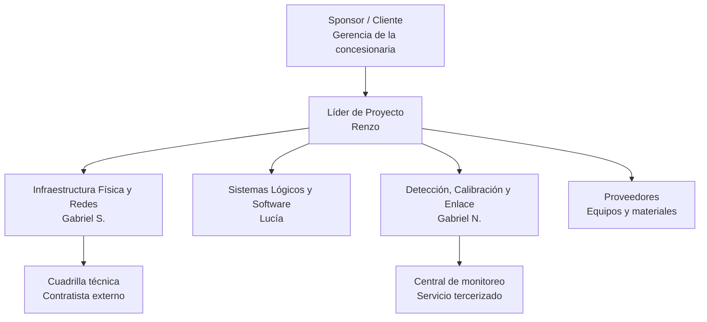

# 🏗️ Estructura Inicial del Equipo

> Propuesta inicial: se ajusta después, con la carga real de trabajo, en la Tarea 4 (RACI).
>
> Definición institucional: los cuatro integrantes NO son empleados de la concesionaria. Son los ingenieros y directores técnicos de una EMPRESA INTEGRADORA de ingeniería y seguridad electrónica. Es un contrato formal llave en mano: la concesionaria financia y valida, la integradora planifica, compra, dirige la obra y calibra los sistemas.

## Roles y responsabilidades

| Rol | Responsabilidades principales | Perfil requerido |
|-----|-------------------------------|------------------|
| Líder de Proyecto / Gestión y Adquisiciones | Interlocución formal con la gerencia de la concesionaria. Control del presupuesto cerrado, emisión y seguimiento de compras, cronograma general y gestión de riesgos. | Gestión de proyecto, interlocución con cliente, control de presupuesto y compras, gestión de riesgos. |
| Responsable de Infraestructura Física y Redes | Cálculo de enlaces y cableado exterior UV, plano de canalizaciones, dimensionamiento del rack y respaldo UPS. Dirección y supervisión técnica en campo de la cuadrilla externa. | Ingeniería y redes, cálculo de enlaces y cableado exterior UV, dimensionamiento de rack y UPS, supervisión de obra en campo. |
| Responsable de Sistemas Lógicos y Software | Configuración del NVR y plataforma de video. Parametrización de perfiles de usuario en app móvil (Ley 25.326). Elaboración de manuales operativos y dictado de capacitaciones. | Configuración de NVR y VMS, parametrización de perfiles y permisos en app móvil según Ley 25.326, documentación y capacitación. |
| Responsable de Detección, Calibración y Enlace | Calibración de sensibilidad ambiental de sensores perimetrales en intemperie. Análisis de ángulos y puntos ciegos. Homologación de protocolos con la central de monitoreo externa. | Calibración de sensores perimetrales en intemperie, análisis de ángulos y puntos ciegos, homologación de protocolos con central externa. |

## Asignación de personas

| Rol | Persona (integrante del equipo) | Observaciones |
|-----|---------------------------------|---------------|
| Líder de Proyecto / Gestión y Adquisiciones | Renzo | Fases 1 a 4. Tiene el voto decisorio en caso de desacuerdo en Nivel 2. Canaliza en exclusiva los cambios Nivel 3. |
| Responsable de Infraestructura Física y Redes | Gabriel S. | Fases 1 y 2. |
| Responsable de Sistemas Lógicos y Software | Lucía | Fases 3 y 4. |
| Responsable de Detección, Calibración y Enlace | Gabriel N. | Fases 1, 3 y 4. |

> Dedicación: equipo de cuatro ingenieros con dedicación parcial estructurada, 10 a 15 horas semanales por integrante.

## Usuarios y áreas involucradas

> Personas o áreas externas al equipo que participan o se ven afectadas (usuarios, otras áreas de la organización, proveedores, etc.).

| Usuario / Área | Participación en el proyecto |
|----------------|------------------------------|
| Gerencia de la concesionaria (Cliente y patrocinador) | Define los requisitos de negocio, financia, aprueba cambios y firma las actas. |
| Administración de la concesionaria (Área del cliente y usuario) | Usa la plataforma y la app según sus permisos; recibe la guía administrativa. |
| Sereno y personal autorizado (Usuarios) | Reciben avisos y ven cámaras según sus permisos. Participan en simulacros y capacitación. |
| Servicio técnico y patio, operaciones (Área del cliente involucrada) | Acuerda accesos y horarios de obra para no interrumpir la operativa comercial. |
| Cuadrilla técnica de instalación (Contratista externo) | Ejecuta zanjeo, canalizaciones, tendido de cable y fijación de postes, bajo supervisión del responsable de infraestructura. |
| Central de monitoreo (Servicio tercerizado) | Recibe las señales de alarma; homologa el protocolo y participa en las pruebas de disparo. |
| Proveedores de equipos y materiales (Proveedores externos) | Cotizan y entregan cámaras, sensores, UPS, rack y cableado. |

## Organigrama

> La Empresa Integradora (los 4 integrantes) es la firma proveedora responsable de consultoría, ingeniería de detalle, adquisición de hardware, configuración de software, dirección técnica y puesta en marcha integral. El Cliente (la concesionaria) es titular del predio y de los activos.

## Niveles de decisión y protocolos de comunicación

> Las reglas resuelven cómo opera el grupo en la práctica. Para decidir a qué nivel corresponde cada decisión o pedido de cambio: primero se pregunta si toca lo acordado con el cliente (Nivel 3); si no, si afecta a más de un área (Nivel 2); en el resto de los casos lo resuelve el responsable (Nivel 1).

| Nivel | Alcance | Cómo se decide |
|-------|---------|----------------|
| Nivel 1 (Técnico / Operativo) | Aspectos técnicos del paquete de trabajo del responsable, sin requerir reuniones, siempre que no altere costos ni fechas. | Plena autonomía del responsable asignado. |
| Nivel 2 (Proyecto / Coordinación Interna) | Decisiones que afectan a más de un área o al cronograma semanal. | Se tratan en la reunión de sincronización (45 min semanales). En caso de desacuerdo, el Líder de Proyecto tiene el voto decisorio. |
| Nivel 3 (Contractual / Control de Cambios) | Cualquier solicitud de modificación de alcance, presupuesto o plazo con el cliente. | Es canalizada exclusivamente por el Líder de Proyecto y requiere aprobación firmada de la gerencia. Si se aprueba, se actualiza la línea base. |

---

*Área de Posgrado · Gestión de Proyectos · Especializaciones FIUNER · 2026*
