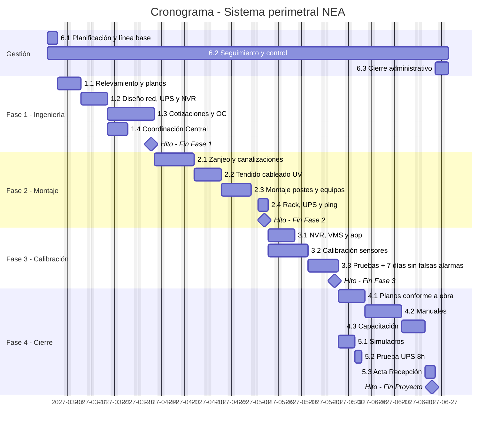

# 📅 Cronograma del Proyecto

> Proyecto: Sistema integrado de detección de intrusiones y videovigilancia perimetral. Inicio: 2027-03-01. Fin: 2027-06-28. Duración: 86 días hábiles. Calendario: lunes a viernes, fines de semana excluidos. Las fechas son las previstas del proyecto, no las del curso.

## Diagrama de Gantt

> Nota sobre el Gantt: 3.1 y 3.2 arrancan en paralelo el 2027-05-06. 3.3 arranca el 2027-05-18 porque necesita que terminen 3.1, 3.2 y 1.4. 5.1 arranca el 2027-05-27 en paralelo a 4.1, pero 5.3 espera a que terminen 4.3 y 5.2.

## Tabla de tareas

| ID | Tarea | Predecesoras | Responsable | Duración (d) | Inicio | Fin | Hito | Crítica |
|----|-------|-------------|------------|:------------:|--------|-----|:----:|:-------:|
| 6.1 | Planificación y línea base | — | Renzo | 3 | 2027-03-01 | 2027-03-03 | No | Sí |
| 6.2 | Seguimiento y control + gestión de riesgos | — (paralelo) | Renzo | 86 | 2027-03-01 | 2027-06-28 | No | No |
| 1.1 | Relevamiento planimétrico y planos de tendido | 6.1 | Gabriel S. | 5 | 2027-03-04 | 2027-03-10 | No | Sí |
| 1.2 | Diseño de red, cálculo UPS y dimensionamiento NVR | 1.1 | Gabriel S. | 6 | 2027-03-11 | 2027-03-18 | No | Sí |
| 1.3 | Cotizaciones, pliego de montaje y órdenes de compra | 1.2 | Renzo | 10 | 2027-03-19 | 2027-04-01 | No | Sí |
| 1.4 | Coordinación previa protocolo con Central de Monitoreo | 1.2 | Gabriel N. | 4 | 2027-03-19 | 2027-03-24 | No | No |
| 2.1 | Zanjeo y canalizaciones (cuadrilla externa) | 1.3 | Gabriel S. | 8 | 2027-04-02 | 2027-04-13 | No | Sí |
| 2.2 | Tendido de cableado UV | 2.1 | Gabriel S. | 6 | 2027-04-14 | 2027-04-21 | No | Sí |
| 2.3 | Montaje de postes, cámaras y sensores | 2.2 | Gabriel S. | 7 | 2027-04-22 | 2027-04-30 | No | Sí |
| 2.4 | Instalación rack y UPS + prueba ping 100% | 2.3 | Gabriel S. | 3 | 2027-05-03 | 2027-05-05 | No | Sí |
| 3.1 | Configuración NVR/VMS y matriz usuarios app (Ley 25.326) | 2.4 | Lucía | 6 | 2027-05-06 | 2027-05-13 | No | No |
| 3.2 | Calibración iterativa de sensores en terreno | 2.4 | Gabriel N. | 8 | 2027-05-06 | 2027-05-17 | No | Sí |
| 3.3 | Pruebas de disparo con Central + 7 días sin falsas alarmas | 3.1, 3.2, 1.4 | Gabriel N. | 7 | 2027-05-18 | 2027-05-26 | No | Sí |
| 4.1 | Planos conforme a obra | 3.3 | Gabriel S. | 6 | 2027-05-27 | 2027-06-03 | No | Sí |
| 4.2 | Manual de usuario y guía administrativa | 4.1 | Lucía | 7 | 2027-06-04 | 2027-06-14 | No | Sí |
| 4.3 | Capacitación sereno y administración + actas | 4.2 | Lucía | 5 | 2027-06-15 | 2027-06-21 | No | Sí |
| 5.1 | Simulacros diurno y nocturno de intrusión | 3.3 | Gabriel N. | 3 | 2027-05-27 | 2027-05-31 | No | No |
| 5.2 | Prueba de corte y autonomía real UPS 8h | 5.1 | Gabriel S. | 2 | 2027-06-01 | 2027-06-02 | No | No |
| 5.3 | Acta de Recepción Definitiva y garantía 12 meses | 4.3, 5.2 | Renzo | 3 | 2027-06-22 | 2027-06-24 | No | Sí |
| 6.3 | Cierre administrativo del proyecto | 5.3 | Renzo | 2 | 2027-06-25 | 2027-06-28 | No | Sí |
| M1 | Fin Fase 1: Plan Ingeniería Aprobado + OC emitidas | 1.3 | Renzo | 0 | 2027-04-01 | 2027-04-01 | **Sí** | — |
| M2 | Fin Fase 2: Acta Montaje + ping 100% | 2.4 | Gabriel S. | 0 | 2027-05-05 | 2027-05-05 | **Sí** | — |
| M3 | Fin Fase 3: 7 días sin falsas alarmas + enlace central | 3.3 | Gabriel N. | 0 | 2027-05-26 | 2027-05-26 | **Sí** | — |
| M4 | Fin Proyecto: Acta Recepción Definitiva firmada | 5.3 | Renzo | 0 | 2027-06-24 | 2027-06-24 | **Sí** | — |

## Hitos y compuertas

| Hito | Fecha | Criterio de aceptación | Quién firma |
|------|-------|----------------------|-------------|
| M1 Fin Fase 1 | 2027-04-01 | Plan de Ingeniería aprobado por escrito + órdenes de compra confirmadas | Gerencia concesionaria |
| M2 Fin Fase 2 | 2027-05-05 | Acta de Montaje Físico firmada + 100% dispositivos con ping | Gabriel S. + Cliente |
| M3 Fin Fase 3 | 2027-05-26 | Informe 7 días corridos sin falsas alarmas + acuse de recibo de la central | Gabriel N. + Central |
| M4 Fin Proyecto | 2027-06-24 | Acta de Recepción Definitiva firmada tras simulacro exitoso + autonomía UPS 8 h verificada | Gerencia concesionaria |

## Supuestos del cronograma

- **Calendario:** lunes a viernes, fines de semana excluidos. No se prevén feriados dentro del período. Si un feriado cae en el camino crítico, la fecha final se corre 1 día.
- **Dedicación:** 3 h/día por integrante (15 h/semana). Las tareas de cuadrilla (2.1 a 2.3) son a tiempo completo de la cuadrilla, no del equipo.
- **Línea base:** este cronograma es la línea base. Cualquier cambio de alcance, costo o plazo pasa por Nivel 3 (Líder de Proyecto + Gerencia) y requiere aprobación firmada, según Tarea 2.
- **Control:** reunión semanal de sincronización de 45 min los lunes, con revisión de avance vs. línea base, tablero Kanban y registro de riesgos.
- **Riesgos que pueden mover la fecha:** demora de proveedores en 1.3, lluvia en Fase 2, y necesidad de una iteración extra de calibración en 3.2. Los 3 están en el registro de riesgos con plan de respuesta.

## Lectura rápida para la defensa

- El proyecto dura 86 días hábiles, no 86 días corridos, porque se trabaja de lunes a viernes.
- El camino crítico pasa por compras, obra y calibración. Ahí no hay holgura.
- La holgura de 13 días en simulacros (5.1, 5.2) es intencional: permite repetir un simulacro sin mover la fecha de entrega.
- La Fase 3 es la única iterativa. Las demás son predictivas, con compuerta de salida obligatoria.

---

*Área de Posgrado · Gestión de Proyectos · Especializaciones FIUNER · 2026 · Equipo 4*
