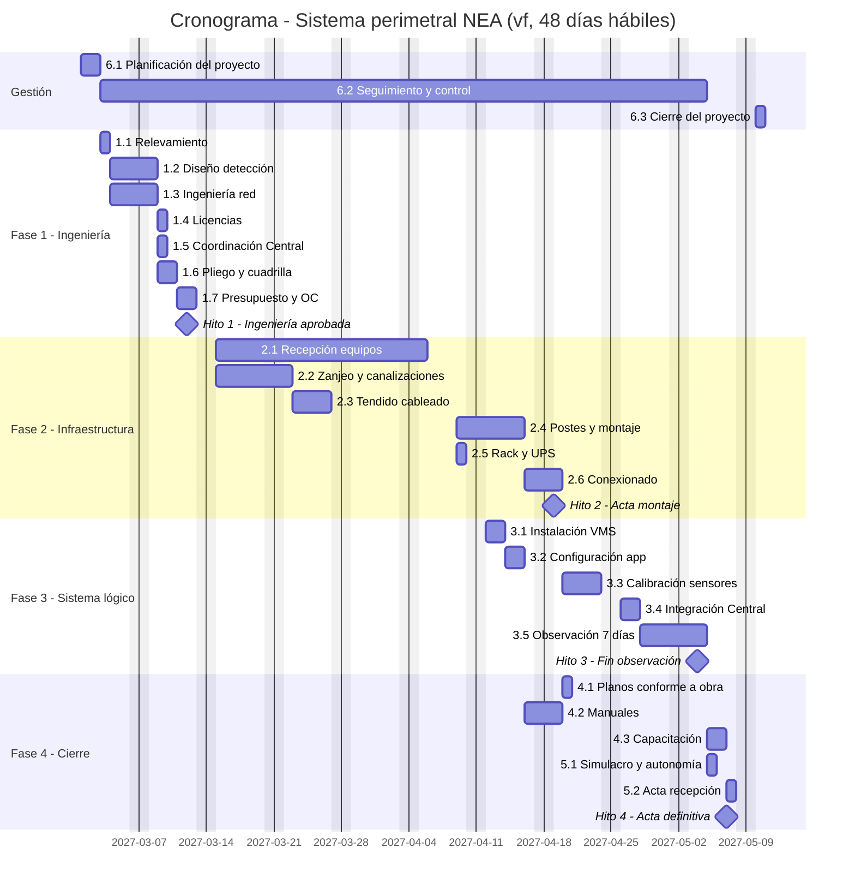

# Tarea 3 — Cronograma
## Sistema integrado de detección de intrusiones y videovigilancia perimetral · Equipo 4 · Gestión de Proyectos · FIUNER

> **Fuente:** Documento `Tarea3_EDT_y_estimaciones_G4_vf.docx`.
> Proyecto: Sistema integrado de detección de intrusiones y videovigilancia perimetral. Inicio: 2027-03-01. Fin: 2027-05-10. Duración: 48 días hábiles. Calendario: lunes a viernes, fines de semana excluidos. Las fechas son las previstas del proyecto, no las del curso.

## 5. Cronograma

### Diagrama de Gantt

> **Figura 5: Diagrama de Gantt con hitos, marzo a mayo de 2027.**
>
> Nota sobre el Gantt: 1.2 y 1.3 arrancan en paralelo el 04/03. 1.4, 1.5 y 1.6 arrancan en paralelo el 09/03. 2.1 y 2.2 arrancan en paralelo el 15/03: la espera de proveedores (2.1) corre mientras la cuadrilla hace zanjeo (2.2) y cableado (2.3). 2.5 dura 1 día (09/04), no 3: ese día Gabriel S. instala rack y UPS en el galpón mientras la cuadrilla hace 2.4. 3.1 y 3.2 (12-15/04) se adelantan a 2.6 porque solo necesitan 2.5, no el montaje completo. 3.5 son 7 días corridos (28/04 al 04/05) que en el Gantt se ven como 5 días hábiles por la exclusión de fines de semana.

Las fechas del cronograma son las previstas para el proyecto, no las del curso. Los cuatro hitos coinciden con los criterios de salida de las fases definidos en la Tarea 2.

Los hitos duran cero días. Marcan el momento en que se cumple una condición, no un trabajo. Por ejemplo, los 7 días sin falsas alarmas son la tarea 3.5, que va del 28/04/27 al 04/05/27 (7 días corridos, que incluyen un fin de semana); el Hito 3 es el cierre de ese período, cuando se firma el informe.

### Tabla 10 — Cronograma con fechas, responsables e hitos

| ID | Tarea | Predecesoras | Responsable | Dur. (d) | Inicio | Fin | Hito | Crítica |
| --- | --- | --- | --- | :---: | --- | --- | --- | :---: |
| 6.1 | Planificación del proyecto | — | Renzo | 2 | 01/03/27 | 02/03/27 | No | Sí |
| 1.1 | Relevamiento del predio y zonas críticas | 6.1 | Gabriel S. | 1 | 03/03/27 | 03/03/27 | No | Sí |
| 1.2 | Diseño de detección y cobertura de cámaras | 1.1 | Gabriel N. | 3 | 04/03/27 | 08/03/27 | No | No |
| 1.3 | Ingeniería de red, canalizaciones y energía | 1.1 | Gabriel S. | 3 | 04/03/27 | 08/03/27 | No | Sí |
| 1.4 | Confirmación de versión y compra de licencias | 1.2 | Lucía | 1 | 09/03/27 | 09/03/27 | No | No |
| 1.5 | Coordinación técnica con la central de monitoreo | 1.2 | Gabriel N. | 1 | 09/03/27 | 09/03/27 | No | No |
| 1.6 | Pliego de montaje y contratación de la cuadrilla | 1.3 | Gabriel S. | 2 | 09/03/27 | 10/03/27 | No | Sí |
| 1.7 | Presupuesto final, aprobación y órdenes de compra | 1.2, 1.3, 1.4, 1.5, 1.6 | Renzo | 2 | 11/03/27 | 12/03/27 | No | Sí |
| H1 | Hito 1 · Ingeniería aprobada y órdenes de compra emitidas | 1.7 | — | 0 | 12/03/27 | 12/03/27 | Sí | — |
| 2.1 | Recepción de equipos y licencias | 1.7 | Renzo | 16 | 15/03/27 | 08/04/27 | No | Sí |
| 2.2 | Zanjeo y canalizaciones | 1.7 | Gabriel S. | 6 | 15/03/27 | 22/03/27 | No | No |
| 2.3 | Tendido de cableado exterior | 2.2 | Gabriel S. | 4 | 23/03/27 | 30/03/27 | No | No |
| 2.4 | Postes y montaje de cámaras y sensores | 2.3, 2.1 | Gabriel S. | 5 | 09/04/27 | 15/04/27 | No | Sí |
| 2.5 | Instalación de rack y UPS | 2.1 | Gabriel S. | 1 | 09/04/27 | 09/04/27 | No | No |
| 2.6 | Conexionado y prueba de comunicación | 2.4, 2.5 | Gabriel S. | 2 | 16/04/27 | 19/04/27 | No | Sí |
| H2 | Hito 2 · Acta de montaje y 100 % de equipos en red | 2.6 | — | 0 | 19/04/27 | 19/04/27 | Sí | — |
| 3.1 | Instalación y activación del VMS | 2.5 | Lucía | 2 | 12/04/27 | 13/04/27 | No | No |
| 3.2 | Configuración de app y perfiles de usuario | 3.1 | Lucía | 2 | 14/04/27 | 15/04/27 | No | No |
| 3.3 | Calibración de sensores en sitio | 2.6 | Gabriel N. | 4 | 20/04/27 | 23/04/27 | No | Sí |
| 3.4 | Integración y pruebas con la central | 3.2, 3.3 | Gabriel N. | 2 | 26/04/27 | 27/04/27 | No | Sí |
| 3.5 | Observación de 7 días corridos sin falsas alarmas | 3.4 | Gabriel N. | 5 | 28/04/27 | 04/05/27 | No | Sí |
| H3 | Hito 3 · Fin de la observación: 7 días corridos sin falsas alarmas (tarea 3.5) y enlace verificado | 3.5 | — | 0 | 04/05/27 | 04/05/27 | Sí | — |
| 4.1 | Planos conforme a obra | 2.6 | Gabriel S. | 1 | 20/04/27 | 20/04/27 | No | No |
| 4.2 | Manuales de usuario y guía administrativa | 3.2 | Lucía | 2 | 16/04/27 | 19/04/27 | No | No |
| 4.3 | Capacitación de usuarios | 3.5, 4.2 | Lucía | 2 | 05/05/27 | 06/05/27 | No | Sí |
| 5.1 | Simulacro de intrusión y prueba de autonomía | 3.5 | Gabriel N. | 1 | 05/05/27 | 05/05/27 | No | No |
| 5.2 | Acta de recepción, garantía y traspaso de soporte | 4.1, 4.3, 5.1 | Renzo | 1 | 07/05/27 | 07/05/27 | No | Sí |
| H4 | Hito 4 · Acta de recepción definitiva | 5.2 | — | 0 | 07/05/27 | 07/05/27 | Sí | — |
| 6.2 | Seguimiento y control | 6.1 | Renzo | 45 | 03/03/27 | 07/05/27 | No | No |
| 6.3 | Cierre del proyecto | 5.2 | Renzo | 1 | 10/05/27 | 10/05/27 | No | Sí |

**Fechas clave:**

- Inicio: 01/03/2027 (día 1)
- Hito 1: 12/03/2027
- Hito 2: 19/04/2027
- Hito 3: 04/05/2027
- Hito 4: 07/05/2027
- Fin del proyecto (6.3): 10/05/2027
- Duración total: 48 días hábiles

### Hitos y compuertas

| Hito | Fecha | Criterio de aceptación | Quién firma |
| --- | --- | --- | --- |
| H1 Fin Fase 1 | 12/03/2027 | Ingeniería aprobada por escrito + órdenes de compra emitidas | Gerencia concesionaria |
| H2 Fin Fase 2 | 19/04/2027 | Acta de montaje firmada + 100 % de equipos con comunicación de red comprobada | Gabriel S. + Cliente |
| H3 Fin Fase 3 | 04/05/2027 | Informe de 7 días corridos sin falsas alarmas + acuse de la central | Gabriel N. + Central |
| H4 Fin Proyecto | 07/05/2027 | Acta de recepción definitiva firmada tras simulacro exitoso + autonomía UPS ≥ 8 h verificada | Gerencia concesionaria |

### Supuestos del cronograma

- **Calendario:** lunes a viernes, fines de semana excluidos. Se excluyen los feriados nacionales del período (24/3, 26/3, 2/4 y 25/5). Si un feriado cae en el camino crítico, la fecha final se corre 1 día.
- **Dedicación:** equipo a tiempo completo (100 %), salvo 6.2 (13 %) y 3.5 (25 % en control diario). La cuadrilla externa trabaja a tiempo completo en 2.2, 2.3 y 2.4.
- **Línea base:** este cronograma es la línea base. Cualquier cambio de alcance, costo o plazo pasa por Nivel 3 (Líder de Proyecto + Gerencia) y requiere aprobación firmada, según Tarea 2.
- **Control:** reunión semanal de sincronización, con revisión de avance vs. línea base y registro de riesgos.
- **Riesgos que pueden mover la fecha:** demora de proveedores en 2.1, lluvia en Fase 2, y necesidad de una iteración extra de calibración en 3.3. Los 3 están en el registro de riesgos con plan de respuesta.

### Lectura rápida para la defensa

- El proyecto dura 48 días hábiles, no 48 días corridos, porque se trabaja de lunes a viernes.
- El camino crítico pasa por ingeniería de red, entrega de proveedores, montaje y calibración. Ahí no hay holgura.
- La holgura de 12 días en 4.1 y 11 días en 4.2 es intencional: permite absorber atrasos de documentación sin mover la fecha final.
- La Fase 3 es la única iterativa. Las demás son predictivas, con compuerta de salida obligatoria.
- 3.5 son 7 días corridos (28/04 al 04/05), que en días hábiles se cuentan como 5 días en la red.
- 6.2 dura 45 días (03/03 al 07/05) con 48 h de esfuerzo, dedicación de alrededor del 13 % para Renzo.
- 2.5 dura 1 día (09/04), no 3. El solape con 2.4 (09-15/04) es solo ese día: la cuadrilla ejecuta 2.4 y Gabriel S. ejecuta 2.5 en el galpón, con supervisión puntual de 2.4.

> Fuente: Tarea 3 — EDT y estimaciones, Equipo 4, versión final del grupo (858 h, 48 días hábiles, 01/03/2027 a 10/05/2027). Costos no incluidos.

---

*Área de Posgrado · Gestión de Proyectos · Especializaciones FIUNER · 2026*
