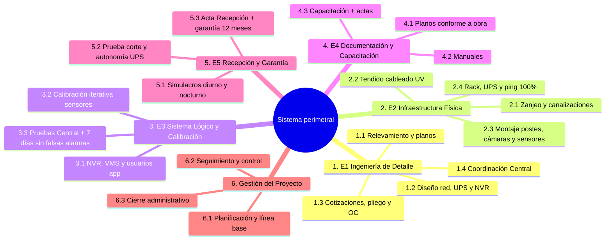

# Estructura de Desglose del Trabajo (EDT / WBS)

> Proyecto: Sistema integrado de detección de intrusiones y videovigilancia perimetral — Concesionaria de maquinaria pesada, NEA. Empresa integradora Equipo 4.
> Los entregables del primer nivel provienen de `entregables.md` (Tarea 2, E1 a E5). La EDT cubre el 100% del alcance y nada más. La Gestión del Proyecto se incluye como paquete de apoyo, no como entregable para el cliente.

## Diagrama de la EDT

> **Regla del 100%:** la suma de los paquetes de trabajo es exactamente el alcance. No hay trabajo fuera de la EDT, y no hay entregables fuera del alcance de la Tarea 2.

## Cómo leer esta EDT

- **Nivel 1 = entregables E1 a E5 + Gestión.** Los E1 a E5 son lo que recibe y firma el cliente. Gestión es trabajo interno necesario para dirigir el proyecto.
- **Nivel 2 = paquetes de trabajo.** Es la unidad que se estima, se asigna y se controla. Cada paquete tiene un responsable primario, una descripción y un criterio de completitud verificable.
- **No se confunde entregable con actividad.** Por ejemplo, E2 no es 'trabajar en el patio', es infraestructura montada, energizada y con ping verificado.
- **Exclusiones que NO están en la EDT:** obra civil mayor y albañilería, abono mensual de monitoreo, sereno o custodia presencial, provisión de celulares/tablets, y ampliación a depósitos no contemplados. Cualquier pedido de ese tipo es un cambio Nivel 3 y requiere adenda.

## Diccionario de la EDT

| ID | Paquete de trabajo | Entregable asociado | Descripción | Criterio de completitud | Responsable |
|----|-------------------|---------------------|-------------|------------------------|-------------|
| 6.1 | Planificación y línea base | Gestión | Planificación y línea base: acta de inicio, EDT, cronograma base, registro de riesgos y plan de comunicación. Deja fija la línea base de alcance, costo y plazo al salir de Fase 1. | Línea base aprobada por el equipo y cronograma base firmado en reunión de sincronización. | Renzo |
| 1.1 | Relevamiento planimétrico y planos de tendido | E1 | Relevamiento planimétrico del patio y galpones, identificación de puntos ciegos, zonas críticas y recorridos. Plano de tendido y ubicación de postes, cámaras y sensores. | Plano de tendido v1 aprobado internamente, con 100% de zonas críticas relevadas y puntos ciegos identificados. | Gabriel S. |
| 1.2 | Diseño de red, cálculo UPS y dimensionamiento NVR | E1 | Diseño de red exterior, cálculo eléctrico de UPS para autonomía 8 h o más, dimensionamiento del NVR para retención 30 días y selección de equipos IP66/IK10. | Memoria de cálculo UPS y dimensionamiento NVR revisados, con equipos seleccionados y justificados. | Gabriel S. |
| 1.3 | Cotizaciones, pliego de montaje y órdenes de compra | E1 | Solicitud de cotizaciones a proveedores, comparación, pliego de montaje para la cuadrilla y emisión de órdenes de compra firmes. Incluye 5 días de espera de cotizaciones dentro de los 10 días de duración. | Órdenes de compra emitidas y confirmadas por proveedores, con pliego entregado a la cuadrilla. | Renzo |
| 1.4 | Coordinación previa protocolo con Central de Monitoreo | E1 | Coordinación previa con la Central de Monitoreo Externa: protocolo de comunicación, formato de señal, tiempos de aviso 30 s o menos y datos de contacto. | Protocolo homologado por escrito con la central, con responsable y canal de prueba definidos. | Gabriel N. |
| 2.1 | Zanjeo y canalizaciones (cuadrilla externa) | E2 | Zanjeo perimetral y colocación de tritubos/caños por cuadrilla externa, bajo supervisión de Gabriel S. Esfuerzo del equipo = supervisión, duración = cuadrilla a tiempo completo. | Canalizaciones terminadas y verificadas según plano, con acta de supervisión firmada. | Gabriel S. |
| 2.2 | Tendido de cableado UV | E2 | Tendido de cableado de red exterior UV, identificación y ordenamiento en rack. Supervisión del equipo, ejecución por cuadrilla. | Cableado tendido, etiquetado y con continuidad verificada tramo por tramo. | Gabriel S. |
| 2.3 | Montaje de postes, cámaras y sensores | E2 | Fijación de postes y montaje mecánico de cámaras IP y sensores perimetrales, energización y ajuste mecánico de ángulos. | 100% de dispositivos montados, fijados y energizados según plano. | Gabriel S. |
| 2.4 | Instalación rack y UPS + prueba ping 100% | E2 | Instalación de rack y UPS en galpón, conexionado, energización y prueba de ping al 100% de dispositivos. | Acta de Montaje Físico firmada + 100% de dispositivos con ping exitoso. | Gabriel S. |
| 3.1 | Configuración NVR/VMS y matriz usuarios app (Ley 25.326) | E3 | Configuración de NVR y VMS, creación de matriz de usuarios y perfiles en app móvil según Ley 25.326, permisos por rol y aviso por sector. | NVR/VMS configurados, matriz de usuarios activa y app con aviso que indica el sector. | Lucía |
| 3.2 | Calibración iterativa de sensores en terreno | E3 | Calibración iterativa de sensores en terreno: ensayos de cruce, ajuste de sensibilidad y filtros por viento, ramas y sombras de maquinaria. Se empieza por un sector y se replica lo aprendido. | Sensores calibrados por sector, con registro de ajustes y falsas alarmas por iteración. | Gabriel N. |
| 3.3 | Pruebas de disparo con Central + 7 días sin falsas alarmas | E3 | Pruebas de disparo con la Central Externa y período de observación de 7 días corridos en intemperie. Duración = calendario de observación, esfuerzo = monitoreo y registro. | Informe de 7 días corridos sin falsas alarmas + acuse de recibo de la central. | Gabriel N. |
| 4.1 | Planos conforme a obra | E4 | Planos conforme a obra: actualización de planos con lo realmente ejecutado, recorridos reales y ubicación final de equipos. | Planos conforme a obra entregados y firmados por Gabriel S. | Gabriel S. |
| 4.2 | Manual de usuario y guía administrativa | E4 | Manual de usuario para sereno y guía administrativa para gerencia/administración, con procedimientos de aviso, revisión de video y gestión de usuarios. | Manuales entregados en formato acordado, con versión y fecha. | Lucía |
| 4.3 | Capacitación sereno y administración + actas | E4 | Capacitación a sereno y administración: uso de app, revisión de cámaras, respuesta ante aviso y prueba de simulacro guiado. | Jornadas concluidas con actas firmadas por los usuarios capacitados. | Lucía |
| 5.1 | Simulacros diurno y nocturno de intrusión | E5 | Simulacros de intrusión diurno y nocturno, con registro de detección, tiempo de aviso y respuesta. | Simulacros exitosos con detección en 100% de zonas críticas y aviso en 30 s o menos. | Gabriel N. |
| 5.2 | Prueba de corte y autonomía real UPS 8h | E5 | Prueba de corte de energía y autonomía real de UPS: corte controlado, medición de autonomía y verificación de grabación continua. | Autonomía real de 8 h o más verificada y registrada, con grabación continua durante el corte. | Gabriel S. |
| 5.3 | Acta de Recepción Definitiva y garantía 12 meses | E5 | Acta de Recepción Definitiva y garantía: documento de cierre contractual, transferencia de administración y póliza de garantía 12 meses. | Acta de Recepción Definitiva firmada por la Gerencia de la concesionaria. | Renzo |
| 6.2 | Seguimiento y control + gestión de riesgos | Gestión | Seguimiento semanal 45 min, actualización de tablero Kanban, revisión de registro de riesgos y control de cambios Nivel 1/2/3. Transversal a todo el proyecto. | Actas de reuniones semanales y tablero actualizado, con riesgos revisados. | Renzo |
| 6.3 | Cierre administrativo del proyecto | Gestión | Cierre administrativo: archivo de documentación, lecciones aprendidas, cierre de órdenes de compra y liberación de recursos. | Carpeta de cierre completa y lecciones aprendidas registradas. | Renzo |

## Trazabilidad fase, entregable y compuerta

| Fase | Entregables | Compuerta de salida (Quality Gate) |
|------|-------------|-----------------------------------|
| Fase 1: Inicio e Ingeniería (predictiva) | E1 | Plan de Ingeniería Aprobado por Cliente + Órdenes de Compra emitidas |
| Fase 2: Montaje Físico (predictiva) | E2 | Acta de Montaje Físico firmada + 100% de dispositivos con ping exitoso |
| Fase 3: Integración y Calibración (iterativa) | E3 | Informe: 7 días corridos sin falsas alarmas + enlace con central verificado |
| Fase 4: Cierre y Capacitación (predictiva) | E4 + E5 | Acta de Recepción Definitiva firmada por la Gerencia |

## Supuestos de la EDT

- Equipo de 4 integrantes con dedicación 10 a 15 h semanales por persona. Para la planificación se usa 15 h/semana = 3 h/día hábil por persona.
- La mano de obra física pesada (zanjeo, tendido, fijación) la ejecuta la cuadrilla externa. El esfuerzo del equipo en E2 es supervisión técnica, no ejecución.
- La calibración en Fase 3 es iterativa: se prueba en un sector, se ajusta y se replica al resto. Por eso 3.2 y 3.3 tienen duración por calendario además de esfuerzo.
- Los 5 entregables son llave en mano: la entrega física es única, pero la validación es incremental por hitos.

---

*Área de Posgrado · Gestión de Proyectos · Especializaciones FIUNER · 2026 · Equipo 4*
