# 🕸️ Red de Tareas y Camino Crítico
> Proyecto: Sistema integrado de detección de intrusiones y videovigilancia perimetral. Duración total: 86 días hábiles. Inicio: 2027-03-01. Fin: 2027-06-28. Todas las dependencias son Fin a Inicio (FS), sin adelantos ni retrasos, salvo que se indique lo contrario.

## Diagrama de dependencias

```mermaid
flowchart LR
    INI(["Inicio"]) --> G61["6.1 Planificación<br/>3d"]
    G61 --> T11["1.1 Relevamiento<br/>5d"]
    T11 --> T12["1.2 Diseño red/UPS/NVR<br/>6d"]
    T12 --> T13["1.3 Cotizaciones y OC<br/>10d"]
    T12 --> T14["1.4 Coordinación Central<br/>4d"]
    T13 --> T21["2.1 Zanjeo<br/>8d"]
    T21 --> T22["2.2 Tendido UV<br/>6d"]
    T22 --> T23["2.3 Montaje postes<br/>7d"]
    T23 --> T24["2.4 Rack, UPS y ping<br/>3d"]
    T24 --> T31["3.1 NVR/VMS y app<br/>6d"]
    T24 --> T32["3.2 Calibración<br/>8d"]
    T31 --> T33["3.3 Pruebas + 7 días<br/>7d"]
    T32 --> T33
    T14 --> T33
    T33 --> T41["4.1 Conforme a obra<br/>6d"]
    T33 --> T51["5.1 Simulacros<br/>3d"]
    T41 --> T42["4.2 Manuales<br/>7d"]
    T42 --> T43["4.3 Capacitación<br/>5d"]
    T51 --> T52["5.2 Prueba UPS 8h<br/>2d"]
    T43 --> T53["5.3 Acta Recepción<br/>3d"]
    T52 --> T53
    T53 --> G63["6.3 Cierre<br/>2d"]
    G63 --> FIN(["Fin"])

    style G61 fill:#FFCDD3,stroke:#C62828
    style T11 fill:#FFCDD2,stroke:#C62828
    style T12 fill:#FFCDD2,stroke:#C62828
    style T13 fill:#FFCDD2,stroke:#C62828
    style T21 fill:#FFCDD2,stroke:#C62828
    style T22 fill:#FFCDD2,stroke:#C62828
    style T23 fill:#FFCDD2,stroke:#C62828
    style T24 fill:#FFCDD2,stroke:#C62828
    style T32 fill:#FFCDD2,stroke:#C62828
    style T33 fill:#FFCDD2,stroke:#C62828
    style T41 fill:#FFCDD2,stroke:#C62828
    style T42 fill:#FFCDD2,stroke:#C62828
    style T43 fill:#FFCDD2,stroke:#C62828
    style T53 fill:#FFCDD2,stroke:#C62828
    style G63 fill:#FFCDD2,stroke:#C62828
```

> Los nodos en rojo son el camino crítico. Los nodos en blanco (1.4, 3.1, 5.1, 5.2) tienen holgura y pueden atrasarse dentro de su holgura sin atrasar el proyecto. 6.2 Seguimiento y control no aparece en el diagrama porque es paralelo a todo el proyecto (86 días) y no condiciona la fecha.

## Tabla de precedencias (CPM)

Cálculo: Inicio temprano (ES) y Fin temprano (EF) por pasada hacia adelante, Inicio tardío (LS) y Fin tardío (LF) por pasada hacia atrás. Holgura = LS - ES = LF - EF. Holgura 0 = tarea crítica.

| ID | Tarea | Duración (d) | Predecesoras | Inicio temprano | Fin temprano | Inicio tardío | Fin tardío | Holgura | Crítica |
|----|-------|:------------:|--------------|:---------------:|:------------:|:--------------:|:------------:|:-------:|:-------:|
| 6.1 | Planificación y línea base | 3 | — | Día 0 (2027-03-01) | Día 2 (2027-03-03) | Día 0 | Día 2 | 0 d | Sí |
| 1.1 | Relevamiento planimétrico y planos de tendido | 5 | 6.1 | Día 3 (2027-03-04) | Día 7 (2027-03-10) | Día 3 | Día 7 | 0 d | Sí |
| 1.2 | Diseño de red, cálculo UPS y dimensionamiento NVR | 6 | 1.1 | Día 8 (2027-03-11) | Día 13 (2027-03-18) | Día 8 | Día 13 | 0 d | Sí |
| 1.3 | Cotizaciones, pliego de montaje y órdenes de compra | 10 | 1.2 | Día 14 (2027-03-19) | Día 23 (2027-04-01) | Día 14 | Día 23 | 0 d | Sí |
| 1.4 | Coordinación previa protocolo con Central de Monitoreo | 4 | 1.2 | Día 14 (2027-03-19) | Día 17 (2027-03-24) | Día 52 | Día 55 | 38 d | No |
| 2.1 | Zanjeo y canalizaciones (cuadrilla externa) | 8 | 1.3 | Día 24 (2027-04-02) | Día 31 (2027-04-13) | Día 24 | Día 31 | 0 d | Sí |
| 2.2 | Tendido de cableado UV | 6 | 2.1 | Día 32 (2027-04-14) | Día 37 (2027-04-21) | Día 32 | Día 37 | 0 d | Sí |
| 2.3 | Montaje de postes, cámaras y sensores | 7 | 2.2 | Día 38 (2027-04-22) | Día 44 (2027-04-30) | Día 38 | Día 44 | 0 d | Sí |
| 2.4 | Instalación rack y UPS + prueba ping 100% | 3 | 2.3 | Día 45 (2027-05-03) | Día 47 (2027-05-05) | Día 45 | Día 47 | 0 d | Sí |
| 3.1 | Configuración NVR/VMS y matriz usuarios app (Ley 25.326) | 6 | 2.4 | Día 48 (2027-05-06) | Día 53 (2027-05-13) | Día 50 | Día 55 | 2 d | No |
| 3.2 | Calibración iterativa de sensores en terreno | 8 | 2.4 | Día 48 (2027-05-06) | Día 55 (2027-05-17) | Día 48 | Día 55 | 0 d | Sí |
| 3.3 | Pruebas de disparo con Central + 7 días sin falsas alarmas | 7 | 3.1, 3.2, 1.4 | Día 56 (2027-05-18) | Día 62 (2027-05-26) | Día 56 | Día 62 | 0 d | Sí |
| 4.1 | Planos conforme a obra | 6 | 3.3 | Día 63 (2027-05-27) | Día 68 (2027-06-03) | Día 63 | Día 68 | 0 d | Sí |
| 4.2 | Manual de usuario y guía administrativa | 7 | 4.1 | Día 69 (2027-06-04) | Día 75 (2027-06-14) | Día 69 | Día 75 | 0 d | Sí |
| 4.3 | Capacitación sereno y administración + actas | 5 | 4.2 | Día 76 (2027-06-15) | Día 80 (2027-06-21) | Día 76 | Día 80 | 0 d | Sí |
| 5.1 | Simulacros diurno y nocturno de intrusión | 3 | 3.3 | Día 63 (2027-05-27) | Día 65 (2027-05-31) | Día 76 | Día 78 | 13 d | No |
| 5.2 | Prueba de corte y autonomía real UPS 8h | 2 | 5.1 | Día 66 (2027-06-01) | Día 67 (2027-06-02) | Día 79 | Día 80 | 13 d | No |
| 5.3 | Acta de Recepción Definitiva y garantía 12 meses | 3 | 4.3, 5.2 | Día 81 (2027-06-22) | Día 83 (2027-06-24) | Día 81 | Día 83 | 0 d | Sí |
| 6.3 | Cierre administrativo del proyecto | 2 | 5.3 | Día 84 (2027-06-25) | Día 85 (2027-06-28) | Día 84 | Día 85 | 0 d | Sí |

**Camino crítico:** 6.1 → 1.1 → 1.2 → 1.3 → 2.1 → 2.2 → 2.3 → 2.4 → 3.2 → 3.3 → 4.1 → 4.2 → 4.3 → 5.3 → 6.3

**Duración total:** 86 días hábiles (2027-03-01 a 2027-06-28, fines de semana excluidos).

## Cómo interpretar el camino crítico

- **Si una tarea crítica se atrasa 1 día, el proyecto se atrasa 1 día.** No hay holgura para absorberlo. Por eso el control semanal debe enfocarse en 1.3 (compras), 2.1 a 2.4 (obra física) y 3.2 a 3.3 (calibración).
- **1.4 Coordinación con la Central tiene 38 días de holgura.** Puede hacerse en paralelo a 1.3 y 2.x sin problema, pero debe estar cerrada antes de 3.3. No conviene dejarla para el final aunque tenga holgura, porque un cambio de protocolo a último momento sería caro.
- **3.1 NVR/VMS tiene 2 días de holgura.** Es casi crítica. Si se atrasa más de 2 días, pasa a ser crítica y empuja 3.3.
- **5.1 y 5.2 Simulacros y prueba UPS tienen 13 días de holgura.** Se pueden hacer apenas termina 3.3 (27 de mayo) y quedan esperando a que termine 4.3 Capacitación para firmar el Acta en 5.3. Esa holgura es una oportunidad: si hay lluvia o un problema en simulacros, hay margen para repetirlos sin mover la fecha final, siempre que no se supere el 21 de junio.
- **El cuello de botella real es la secuencia compras → obra → calibración.** 1.3 + 2.1 + 2.2 + 2.3 = 31 días hábiles encadenados. Cualquier demora de proveedor o semana de lluvia en el NEA en ese tramo se traslada directo a la fecha de entrega.

## Qué vigilar cada semana (según la red)

1. **En Fase 1:** que las cotizaciones lleguen en los 5 días de espera previstos en 1.3. Si un proveedor demora, hay que activar el segundo proveedor sin esperar al final del plazo.
2. **En Fase 2:** que la cuadrilla cumpla el ritmo (zanjeo 8 d, tendido 6 d, montaje 7 d). El clima es el riesgo externo principal, está en el registro de riesgos.
3. **En Fase 3:** que la calibración no se extienda más de 8 días. Si al día 5 siguen las falsas alarmas por rotación de maquinaria, hay que revisar filtros y no esperar a los 7 días de observación para actuar.
4. **En Fase 4:** que la documentación (4.1, 4.2) no se deje para después de la capacitación. 4.1 a 4.3 son críticas y encadenadas, no hay holgura para reescribir manuales a último momento.

---

*Área de Posgrado · Gestión de Proyectos · Especializaciones FIUNER · 2026 · Equipo 4*
