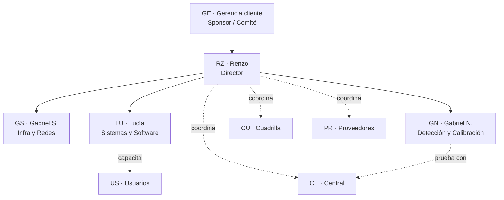
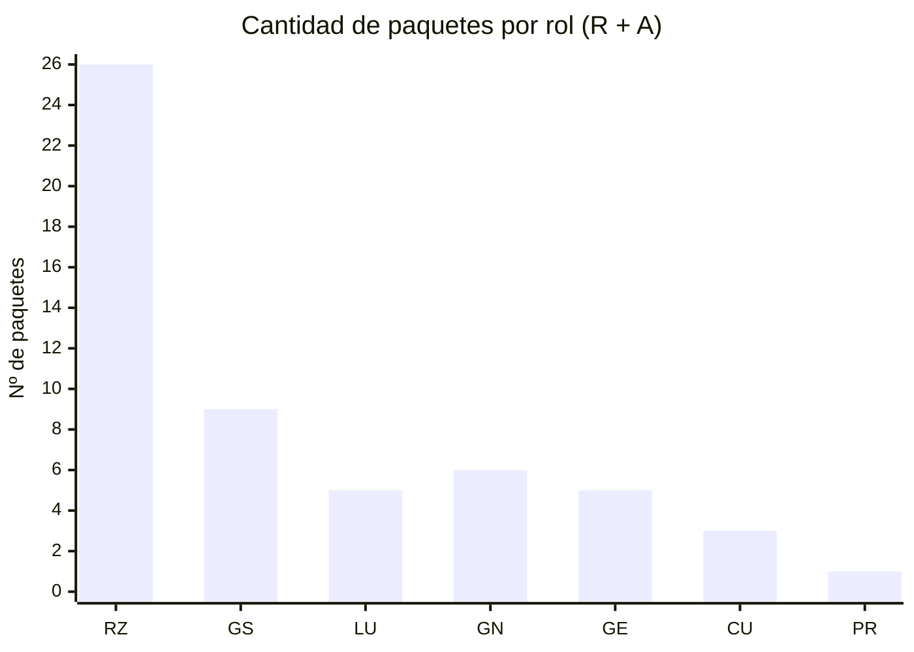

# 👥 Matriz RACI — Versión probable
## Sistema integrado de detección de intrusiones y videovigilancia perimetral · Equipo 4 · Gestión de Proyectos · FIUNER

> **Regla:** **R** = Responsable (ejecuta) · **A** = Aprobador (único por paquete, responde por el resultado) · **C** = Consultado (se le pregunta antes) · **I** = Informado (se le avisa después) · **R/A** = ejecuta y aprueba (solo en gestión) · **—** = sin participación.
> **Verificación:** cada fila tiene exactamente **1 A** y al menos **1 R**.

## 1. Roles del proyecto y personas

Los roles vienen de la Tarea 2, sin cambios de personas. Solo se precisa el alcance para que la RACI no deje huecos. El círculo de gobierno verde no es gente nueva que hay que contratar: es la Gerencia del cliente haciendo de Comité de Dirección, y Renzo absorbiendo las funciones de PMO en 6.1 y 6.2 porque la integradora es de 4 personas.

| Código | Rol | Persona | Círculo | Alcance en este proyecto | Cambio respecto de la Tarea 2 |
|---|---|---|---|---|---|
| **RZ** | Director de Proyecto / Gestión y Compras | Renzo Grilletti | Azul — Equipo | Plan, línea base, presupuesto, compras, seguimiento, cambios Nivel 1 y 2, cierre. Único A de la mayoría de los paquetes técnicos. | Sin cambios. Se explicita que absorbe funciones de PMO. |
| **GS** | Infraestructura Física y Redes | Gabriel S. | Azul — Equipo | Relevamiento, ingeniería de red, pliego de cuadrilla, supervisión de obra, rack/UPS, conexionado, planos conforme a obra. | Sin cambios. Se aclara que en 2.2-2.4 es supervisión parcial, no ejecución 100 %. |
| **LU** | Sistemas Lógicos y Software | Lucía | Azul — Equipo | Licencias VMS/app, instalación VMS, configuración de app y perfiles, manuales, capacitación. Enlace con proveedor de software. | Sin cambios. |
| **GN** | Detección, Calibración y Enlace | Gabriel N. | Azul — Equipo | Diseño de detección, coordinación con central, calibración, integración, observación 7 días, simulacro. | Sin cambios. |
| **GE** | Gerencia de la concesionaria — Sponsor / Comité de Dirección | Gerencia cliente | Verde — Gobierno | Aprueba ingeniería (Hito 1), zonas críticas (1.1), plan (6.1) y recepción definitiva (Hito 4). Aprueba cambios Nivel 3. | Sin cambios. Se la nombra como órgano de gobierno, no como un comité nuevo. |
| **CU** | Cuadrilla externa de obra | Cuadrilla contratada (4 operarios) | Amarillo — Externo | Ejecuta zanjeo, cableado y montaje de postes/cámaras/sensores según pliego. | Sin cambios. |
| **CE** | Central de monitoreo | Central tercerizada, contratada y pagada por el cliente | Amarillo — Externo | Recibe señal de alarma con sector, no video. Acuerda protocolo, participa en pruebas 1.5, 3.4 y 5.1. | Sin cambios. Se aclara que no es proveedora de la integradora. |
| **PR** | Proveedores | Proveedor de hardware + Proveedor habitual de software (VMS/app) | Amarillo — Externo | Entregan equipos y licencias (2.1), dan soporte remoto en 3.1 y consultas de calibración. No desarrollan software. | Sin cambios. Se unifican en una sola columna para que la matriz sea legible. |
| **US** | Usuarios finales | Sereno, Administración y Gerencia usuaria | Amarillo — Externo | Usan el sistema, asisten a capacitación, participan en simulacro. | Sin cambios. |

### Organigrama para la RACI

## 2. Matriz RACI — 26 paquetes

Lectura rápida: **R** hace, **A** responde y firma, **C** opina antes, **I** se entera después.

| ID | Paquete de trabajo | RZ | GS | LU | GN | GE | CU | CE | PR | US |
|---|---|:---:|:---:|:---:|:---:|:---:|:---:|:---:|:---:|:---:|
| 1.1 | Relevamiento del predio y zonas críticas | I | **R** | I | C | **A** | — | — | — | C |
| 1.2 | Diseño de detección y cobertura de cámaras | **A** | C | C | **R** | I | — | — | — | — |
| 1.3 | Ingeniería de red, canalizaciones y energía | **A** | **R** | C | C | I | — | — | — | — |
| 1.4 | Confirmación de versión y compra de licencias | **A** | I | **R** | I | I | — | — | C | — |
| 1.5 | Coordinación técnica con la central de monitoreo | **A** | I | C | **R** | I | — | C | — | — |
| 1.6 | Pliego de montaje y contratación de la cuadrilla | **A** | **R** | I | C | I | C | — | I | — |
| 1.7 | Presupuesto final, aprobación y órdenes de compra | **R** | C | C | C | **A** | I | I | I | — |
| 2.1 | Recepción de equipos y licencias | **R/A** | I | I | — | I | — | — | **R** | — |
| 2.2 | Zanjeo y canalizaciones | **A** | **R** | — | — | I | **R** | — | — | — |
| 2.3 | Tendido de cableado exterior | **A** | **R** | — | — | I | **R** | — | — | — |
| 2.4 | Postes y montaje de cámaras y sensores | **A** | **R** | — | C | I | **R** | — | — | — |
| 2.5 | Instalación de rack y UPS | **A** | **R** | C | — | I | — | — | — | — |
| 2.6 | Conexionado y prueba de comunicación | **A** | **R** | C | C | I | I | — | — | — |
| 3.1 | Instalación y activación del VMS | **A** | I | **R** | I | I | — | — | C | — |
| 3.2 | Configuración de app y perfiles de usuario | **A** | — | **R** | C | I | — | — | C | C |
| 3.3 | Calibración de sensores en sitio | **A** | C | C | **R** | I | — | I | C | I |
| 3.4 | Integración y pruebas con la central | **A** | I | C | **R** | I | — | C | C | I |
| 3.5 | Observación de 7 días corridos sin falsas alarmas | **A** | — | I | **R** | I | — | I | — | I |
| 4.1 | Planos conforme a obra | **A** | **R** | I | C | I | — | — | — | — |
| 4.2 | Manuales de usuario y guía administrativa | **A** | I | **R** | C | I | — | — | C | C |
| 4.3 | Capacitación de usuarios | **A** | — | **R** | C | I | — | I | — | I |
| 5.1 | Simulacro de intrusión y prueba de autonomía | **A** | C | C | **R** | I | — | C | — | C |
| 5.2 | Acta de recepción, garantía y traspaso de soporte | **R** | C | C | C | **A** | I | I | I | I |
| 6.1 | Planificación del proyecto | **R** | C | C | C | **A** | — | — | — | — |
| 6.2 | Seguimiento y control | **R/A** | C | C | C | I | I | I | I | — |
| 6.3 | Cierre del proyecto | **R** | I | I | I | **A** | I | I | I | — |

### Notas de lectura que evitan los errores típicos

- **1.1:** la A es GE, no RZ, porque el criterio es “zonas críticas validadas por el cliente”. GS ejecuta, pero quien puede decir “esta zona sí es crítica” es el cliente.
- **1.7, 5.2, 6.1 y 6.3:** la A es GE porque son los 4 actos formales del proyecto: aprobar ingeniería y gasto, recibir el sistema, aprobar el plan y cerrar. En todo lo demás, la A es RZ para que no haya dos aprobadores.
- **2.1:** hay 2 R porque el trabajo es doble: PR entrega, RZ controla contra la orden de compra. La A sigue siendo una sola: RZ.
- **2.2, 2.3 y 2.4:** hay 2 R porque CU ejecuta la obra y GS supervisa. GS no está al 100 % en la zanja, está en supervisión parcial, por eso no es sobreasignación aunque aparezca como R en 3 paquetes seguidos. Ver sección 4.
- **2.5:** la R es solo GS. No la hace la cuadrilla. En el documento vf, 2.5 dura **1 día (09/04/27)** y 2.4 dura **5 días (09-15/04/27)**. El solape es solo el **09/04**, no 20-22/04 como decía la versión anterior. Se resuelve porque CU ejecuta 2.4 y GS hace 2.5 en el galpón, con supervisión puntual de 2.4 al inicio y cierre de esa jornada, sin mover fechas.
- **3.3 y 3.5:** la R es GN aunque LU y PR sean C. La calibración es iterativa y el responsable de decidir si se reinicia el período de 7 días es GN, con aprobación de RZ en 6.2.
- **3.4 y 5.1:** CE es C, no R ni A, porque la central es tercerizada y pagada por el cliente. La integradora homologa y coordina, no le ordena a la central.
- **US:** nunca es R ni A. En 4.3 y 5.1 es I/C porque participa, pero quien responde por la capacitación y el simulacro es LU y GN respectivamente.

## 3. Análisis de carga de responsabilidades

Conteo sobre la matriz anterior. R/A cuenta como R y como A a la vez.

| Rol | Como R (ejecuta) | Como A (aprueba) | Total R+A | Lectura |
|---|:---:|:---:|:---:|---|
| **RZ Renzo** | 5 | 21 | 26 | Está en todas las filas, pero 21 son como A. Es el cuello de aprobación. No ejecuta obra, ejecuta gestión y compras. |
| **GS Gabriel S.** | 9 | 0 | 9 | Mayor carga de ejecución. Concentrado en Fase 1 (1.1, 1.3, 1.6) y Fase 2 (2.2-2.6) + 4.1. |
| **LU Lucía** | 5 | 0 | 5 | Carga equilibrada, concentrada en Fase 1 (1.4) y Fase 3-4 (3.1, 3.2, 4.2, 4.3). |
| **GN Gabriel N.** | 6 | 0 | 6 | Carga equilibrada, concentrada en Fase 1 (1.2, 1.5) y Fase 3-5 (3.3-3.5, 5.1). |
| **GE Gerencia** | 0 | 5 | 5 | Solo aprueba los hitos formales. No ejecuta. Correcto para un sponsor. |
| **CU Cuadrilla** | 3 | 0 | 3 | Solo obra pesada. No participa en ingeniería ni en sistema lógico. |
| **CE Central** | 0 | 0 | 0 | Nunca R ni A. Es consultada en 1.5, 3.4 y 5.1. Coherente con su rol tercerizado. |
| **PR Proveedores** | 1 | 0 | 1 | Solo entrega en 2.1. En el resto es C o I. |
| **US Usuarios** | 0 | 0 | 0 | Nunca R ni A. Participan como C/I en relevamiento, app, manuales, capacitación y simulacro. |

**Diagnóstico:**

- **RZ no está sobrecargado de ejecución, está sobrecargado de aprobación.** 21 A significa que si RZ se enferma o no responde, se frenan 21 paquetes. Mitigación: en 6.2 se define que los A de paquetes no críticos (por ejemplo 4.2 Manuales) pueden ser aprobados por RZ en la reunión semanal sin esperar un acta formal, mientras que los A de Hitos (1.7, 5.2, 6.1, 6.3) sí requieren firma de GE.
- **GS es el único con riesgo de cuello de botella físico.** Tiene 9 R y 5 de ellos son seguidos en Fase 2. Se equilibra porque en 2.2-2.4 la ejecución real es de CU y GS solo supervisa. Si GS hiciera la zanja él solo, sería inviable. En el vf, 2.5 es de 1 día (09/04), no de 3, por lo que su carga en esa semana es menor que en la versión anterior.
- **LU y GN están equilibrados.** Ninguno supera 6 R y sus paquetes no se solapan: LU hace 3.1-3.2 el 12-15/04 y GN hace 3.3 el 20-23/04, que es secuencial, no paralelo. En el vf, 3.3 dura 4 días (20-23/04), no 6.
- **Nadie queda sin trabajo relevante.** Los 4 integrantes tienen entre 5 y 9 R, que es lo que pide la consigna para un equipo de 4.

## 4. Asignación y dedicación

Supuesto de la Tarea 3: integradora al 100 % (8 h/día, lunes a viernes), cuadrilla al 100 % en obra, 6.2 y 3.5 con dedicación parcial. La tabla usa ese supuesto y verifica que nadie supere el 100 % en el mismo período.

| Integrante | Rol | Dedicación | Período | Total del período | ¿Sobreasignado? | Observaciones |
|---|---|:---:|---|---|:---:|---|
| Renzo | Director / Gestión y Compras | 100 % en 6.1, 1.7, 2.1, 5.2, 6.3 · **13 % en 6.2** (48 h en 45 días, ~1 h/día) | 01/03-10/05/2027 | 100 % | No | En 6.2 no está al 100 % todos los días, es ~1 h/día de seguimiento + coordinación. Por eso puede ser R en 1.7 y 2.1 sin superponerse. Dato del vf, §3.7. |
| Gabriel S. | Infra y Redes | 100 % en 1.1, 1.3, 1.6, 2.5, 2.6, 4.1 · 30 % supervisión en 2.2-2.4 | 03/03-20/04/2027 | 100 % | No, con aclaración | **Solape real en vf: solo 09/04** (2.4: 09-15/04, 2.5: 09/04, 1 día). No es sobreasignación porque en 2.4 la ejecución es de CU y GS solo supervisa puntualmente, y en 2.5 ejecuta en el galpón. La versión anterior decía 20-22/04, que era del cronograma viejo. |
| Lucía | Sistemas y Software | 100 % en 1.4, 3.1, 3.2, 4.2, 4.3 | 09/03-06/05/2027 (intermitente) | 100 % | No | Fechas vf: 1.4 el 09/03, 3.1 el 12-13/04, 3.2 el 14-15/04, 4.2 el 16-19/04, 4.3 el 05-06/05. No se solapa con GN. |
| Gabriel N. | Detección y Calibración | 100 % en 1.2, 1.5, 3.3, 3.4, 5.1 · 25 % en 3.5 (registro diario, 10 h en 5 días hábiles) | 04/03-05/05/2027 | 100 % | No | Fechas vf: 3.3 el 20-23/04 (4 días), 3.4 el 26-27/04, 3.5 el 28/04-04/05 (7 corridos, 5 hábiles), 5.1 el 05/05. En 3.5 no está 8 h/día en el predio, es registro diario. |
| Cuadrilla (4 operarios) | Obra externa | 100 % en 2.2, 2.3, 2.4 | 15/03-15/04/2027 | 100 % | No | Fechas vf: 2.2 el 15-22/03, 2.3 el 23-30/03, 2.4 el 09-15/04. Cada operario al 100 % en su tramo. No participa fuera de Fase 2. |
| Gerencia cliente | Sponsor | 10 % (hitos y aprobaciones) | 03/03, 12/03, 07/05, 10/05/2027 | 10 % | No | Fechas vf: 1.1 el 03/03, Hito 1 el 12/03, 5.2/Hito 4 el 07/05, 6.3 el 10/05. Solo se la convoca para 1.1, 1.7, 5.2, 6.1 y 6.3. |

> **Regla aplicada:** se suma la dedicación de cada integrante en la misma semana. Si GS estuviera al 100 % en 2.4 y al 100 % en 2.5 a la vez, daría 200 % y habría que mover 2.5. Como en 2.4 es supervisión puntual y en 2.5 es 1 solo día (09/04), la suma no supera el 100 % y no se mueve ninguna fecha.

## 5. Ajustes al cronograma

| ID | Duración original (d) | Duración ajustada (d) | Motivo del ajuste |
|---|:---:|:---:|---|
| 2.4 | 5 | 5 | Sin cambio. Fechas vf: 09-15/04/27. Se aclara en RACI que CU ejecuta y GS supervisa. |
| 2.5 | **1** | **1** | **Corregido.** En vf dura 1 día, **09/04/27**, no 3 días. Se mantiene esa fecha porque depende solo de 2.1, no de 2.4. |
| 2.2, 2.3 | 6, 4 | 6, 4 | Sin cambio. Fechas vf: 2.2 el 15-22/03, 2.3 el 23-30/03. Misma aclaración que 2.4. |
| 6.2 | **45** | **45** | **Corregido.** En vf dura 45 días (03/03-07/05/27), no 54. Se precisa dedicación de RZ al **13 % (48 h en 45 días)** para que no parezca que está al 100 % durante 45 días seguidos. |
| Resto | — | — | Sin cambios. Ningún ajuste cambia la secuencia ni el camino crítico. |

**Camino crítico sin cambios en secuencia:** 6.1 → 1.1 → 1.3 → 1.6 → 1.7 → 2.1 → 2.4 → 2.6 → 3.3 → 3.4 → 3.5 → 4.3 → 5.2 → 6.3. **Duración total corregida: 48 días hábiles, 01/03/2027 a 10/05/2027** (Hitos: H1 12/03, H2 19/04, H3 04/05, H4 07/05).

**Conclusión:** la RACI no obliga a mover el cronograma. Solo obliga a precisar que en Fase 2 la ejecución es de la cuadrilla y la supervisión es parcial, y que la aprobación de RZ se concentra en la reunión semanal de 6.2 para no frenar la obra.

---

*Área de Posgrado · Gestión de Proyectos · Especializaciones FIUNER · 2026*

---

### Fe de erratas — corrección al documento vf

La primera versión de este RACI usó por error el cronograma viejo (1058 h / 58 días / cierre 24/05, 2.5 de 3 días, 6.2 de 54 días al 50 %, 3.5 del 12-18/05, 4.3 del 19-20/05). Los valores correctos, del documento **Tarea3_EDT_y_estimaciones_G4_vf.docx**, son: **858 h, 48 días hábiles, 01/03 a 10/05/2027, 2.5 de 1 día (09/04), 6.2 de 45 días al 13 % (48 h), 3.5 del 28/04 al 04/05, 4.3 del 05-06/05, 5.2 el 07/05 y 6.3 el 10/05**. La matriz RACI en sí (quién es R/A/C/I en cada paquete) no cambia, porque no depende de las fechas, solo los datos de duración, dedicación y cronograma de las secciones 4 y 5.
